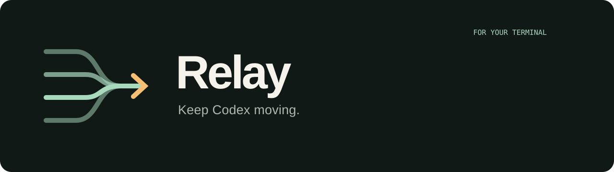

<p align="center"></p>

Relay keeps your Codex sessions moving between your own accounts. When an account
runs out, it finds another available account. When all accounts are waiting for a
reset, it waits too, then continues the saved task.

**macOS · Native Codex terminal · One account or many**

## Get started

You'll need [Codex](https://learn.chatgpt.com/docs/cli), Node.js 20 or newer, and
Python 3.11 or newer. If you use Homebrew, `brew install node python@3.13` installs
Node and Python.

```sh
npm install -g relay-codex
relay setup --count 2
relay run
```

Choose however many accounts you have. Each person signs into their own accounts;
this project does not include anyone's saved logins. Existing logins from the
earlier `codex-accounts` tool are picked up automatically.

The first run downloads Relay's Python libraries. Later runs use the saved copy.
Your usual `codex` command keeps working.

Prefer trying it without a global install?

```sh
npx --yes relay-codex setup --count 2
npx --yes relay-codex run
```

## Use it like Codex

```sh
relay run -- resume --yolo
relay status --watch
```

`--yolo` keeps its usual full-access meaning. Without it, Relay keeps the task's
permissions. Different terminals can work on different conversations at once.

If a conversation is already open in another app, close it there before resuming
it here, or use Codex's `fork` command for a separate copy. To move a Relay task
between terminals:

```sh
relay attach --takeover SESSION_ID
```

## What happens when something stops?

- **Account limit:** use an available account, or wait for the earliest usable reset.
- **One account:** wait for its reset and continue the same conversation.
- **Connection or sign-in failure:** retry at 5, 10, and 15 minutes, then try another account.
- **“Selected model is at capacity”:** wait five minutes and try the same model again.
  Relay keeps waiting rather than cycling logins. A different model is used only
  if you explicitly configure a fallback.
- **An unclear interruption during a command:** pause for review before continuing.
  Relay cannot guarantee that an external action happened exactly once.

## Leave work running

```sh
relay start --name website --cwd ~/projects/website --prompt "Finish the remaining checks"
relay attach SESSION_ID
relay stop SESSION_ID
```

Background tasks keep running after their terminal closes. They do not start
automatically after a Mac reboot. Use `relay status --all` to find saved sessions
and `relay restart SESSION_ID` to recover a stopped one.

## A few useful commands

```sh
relay add personal
relay account disable personal
relay pause SESSION_ID
relay unpause SESSION_ID
relay retry SESSION_ID
relay doctor --self-test
relay menubar
```

Accounts stay in your Mac's Keychain. Relay keeps its settings and task records
in your private Application Support folder. Never share that folder.

## Updates and limits

Relay checks the installed Codex version and keeps a working copy for running
sessions. Future Codex changes may still need a Relay update.
Update Relay with `npm install -g relay-codex@latest`.

This is an independent tool, not an OpenAI product. Short local tests cover
parallel tasks and recovery; they are not an overnight reliability guarantee.

[Commands](docs/commands.md) · [Troubleshooting](docs/troubleshooting.md) ·
[Publishing to npm or Homebrew](docs/publishing.md) · [Contributing](CONTRIBUTING.md)
